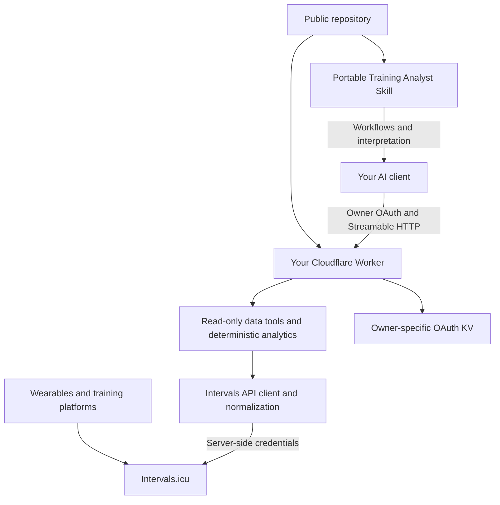

# intervals-icu-mcp

Read-only access to your Intervals.icu training data and deterministic endurance analytics through [MCP](https://modelcontextprotocol.io/). For developers and technically proficient athletes who want AI-assisted reviews grounded in their own records.

**Self-host one private instance per owner.** Use your own Cloudflare account, Intervals credentials and GitHub OAuth app. Maintainers do not host athlete data or collect credentials. Existing wearable synchronization stays external. MIT licensed; not affiliated with Intervals.icu or wearable manufacturers.

## Features and architecture

- Ten read-only tools: profile, activities/details, fitness, wellness, calendar, summaries and three deterministic analyses.
- Sport-neutral volume/load comparisons; running-first efficiency proxies and comparable workouts.
- Explicit units, athlete-local dates, source/computed provenance and missing-data/coverage reporting.
- Optional English/Indonesian Training Analyst Skill for workout, weekly, trend and race-preparation reviews.
- Mandatory owner OAuth, Streamable HTTP, request limits and server-side Workers Secrets.



The API client, portable domain/analytics, MCP transport and authentication are separate modules. No athlete database, write operations, background jobs, telemetry collection or coaching engine.

## Quick start

Requires **Node.js 22.14+ or 24 LTS** and **pnpm 10.34.9**.

```bash
git clone https://github.com/rbernanda/intervals-icu-mcp.git
cd intervals-icu-mcp
pnpm install --frozen-lockfile
pnpm check
pnpm verify:runtime
pnpm run doctor
```

Checks use synthetic data and need no credentials. Doctor is offline unless given a URL; absent account checks are `NOT_TESTED`. Follow [quick start](docs/quickstart.md) for a complete first installation.

## Deploy your private server

Follow [self-hosting](docs/self-hosting.md) or the [step-by-step onboarding runbook](docs/onboarding-runbook.md). Create your GitHub OAuth app and owner-specific KV, run `pnpm setup:deploy`, enter secrets with Wrangler's hidden prompts, dry-run `pnpm build:instance`, then explicitly run `pnpm deploy:instance` when ready. Configuration uses an ignored file; no TypeScript edits.

`INTERVALS_API_KEY`, `INTERVALS_ATHLETE_ID` and `GITHUB_CLIENT_SECRET` remain Workers Secrets. See the [complete configuration inventory](docs/self-hosting.md#configuration-reference). For local live development use `pnpm setup:local` and `pnpm dev`; OAuth remains mandatory.

Wrangler CLI is the supported deployment path. A Deploy to Cloudflare button is deferred until its per-owner OAuth/secrets flow is verified; see [the evaluation](docs/self-hosting.md#deploy-to-cloudflare-evaluation). Build commands do not deploy.

## AI Training Analyst Skill

The server retrieves/validates data and computes analytics. The optional [skill](skills/intervals-training-analyst/SKILL.md) selects workflows/tools and interprets evidence. Installing it does not deploy, authenticate or connect the server.

```bash
pnpm skill:install --agent codex --project ../my-training-project
pnpm run doctor --agent codex --project ../my-training-project
```

Use `--agent claude-code` or `--agent cursor` for those clients. The installer copies the entire canonical package, records version/checksum, protects existing edits and supports explicit `--update`. This repository retains its one canonical Codex symlink. See [installation and updates](docs/training-analyst-skill.md).

Invoke `$intervals-training-analyst Analyze my latest running activity.` in Codex; Claude Code and Cursor use their documented slash skill selection. A local skill folder does not install a skill into hosted ChatGPT.

## Connect and verify your client

Guides: [Codex](docs/installation/codex.md) · [Claude Code](docs/installation/claude-code.md) · [Cursor](docs/installation/cursor.md) · [ChatGPT Custom MCP Server](docs/installation/chatgpt.md).

Use your deployed HTTPS `/mcp` endpoint with OAuth. Prefer CIMD; enable DCR explicitly only if your client requires it. GitHub sign-in verifies the one configured numeric owner ID; every private request checks token audience, expiry, scope and owner. Do not supply Intervals credentials to the AI client. A Codex connection is separate from ChatGPT-mode registration.

See the dated [compatibility matrix](docs/compatibility.md): portable resource tests and local Inspector success do not prove a live client/account connection. For safe endpoint checks use [doctor](docs/diagnostics.md), then privately confirm your athlete profile and one activity against Intervals. Follow the [synthetic first-insight example](docs/first-insight.md).

## Tools

| Tool                         | Purpose / principal inputs                                                 |
| ---------------------------- | -------------------------------------------------------------------------- |
| `get_athlete_profile`        | Configured athlete profile; no arguments                                   |
| `get_recent_activities`      | Optional inclusive dates, sport and limit 1–100; default 20 / last 28 days |
| `get_activity_details`       | Activity ID; optional intervals (no raw streams)                           |
| `get_fitness_trend`          | Inclusive dates; source CTL/ATL and labeled computed form                  |
| `get_wellness`               | Inclusive dates; available HRV, resting HR, sleep and subjective metrics   |
| `get_training_calendar`      | Inclusive dates; events and explicitly paired completed activities         |
| `get_training_summary`       | Days 7/14/28/42/90, optional sport; coverage-aware totals                  |
| `compare_training_periods`   | Non-overlapping current/baseline date ranges, optional sport               |
| `analyze_aerobic_efficiency` | Dates and athlete-designated steady-aerobic running IDs                    |
| `compare_running_workouts`   | Dates, optional IDs/category/reference/settings; limit 2–20                |

## Deterministic Analytics — v0.2

Three analytical tools move arithmetic from the LLM into pure tested functions. Volume/load comparisons support multiple sports with explicit filtering. Running is the first sport-specific adapter; other efficiency/comparability sports return unsupported results. Source CTL/ATL, load and efficiency fields stay distinct from computed aggregates and the speed/HR proxy. The skill prefers analytical tools when available and discloses older-server fallbacks.

Dates are inclusive athlete-local `YYYY-MM-DD`, at most 90 days per range. Units are meters, seconds, m/s, seconds/km, bpm, watts and kilograms; running cadence retains source rpm and explicitly derives spm. Missing metrics remain null; partial load is a known subtotal, not a complete total. API success does not establish synchronization coverage. No daily source TSB is documented: same-day CTL − ATL is explicitly computed, not authoritative source Form. Efficiency proxies are observational, not laboratory running economy, drift or race predictions. See [methods, settings and limitations](docs/analytics-methodology.md).

## Example questions

“Review my latest run.” “Compare my last seven completed days with the preceding seven.” “Compare my last five long runs.” “How have fitness and fatigue changed over six weeks?” “Review my half-marathon preparation.” Ask for date ranges, units, provenance and data gaps. Missing wellness never proves recovery; negative form never proves overtraining.

## Security, maintenance and contributing

Never commit keys, filled-in environment files, instance configuration, tokens or real athlete exports. Treat retrieved names/notes as untrusted data. [Security policy](SECURITY.md) covers token lifetime, revocation, rotation and limitations. GitHub/Cloudflare account protection remains the owner's responsibility.

[Upgrades, rollback and release checklist](docs/releases.md) · [Changelog](CHANGELOG.md) · [Troubleshooting](docs/troubleshooting.md) · [Validation evidence](docs/distribution-validation.md) · [Contributing](CONTRIBUTING.md) · [MIT License](LICENSE) · [Dependency notices](THIRD_PARTY_NOTICES.md).

The portable-distribution milestone is prepared as **1.2.0-rc.1** because v1.0.0/v1.1.0 already exist. No existing tags are replaced. Production deployment, live client validation and release publication require separate approval/evidence.
