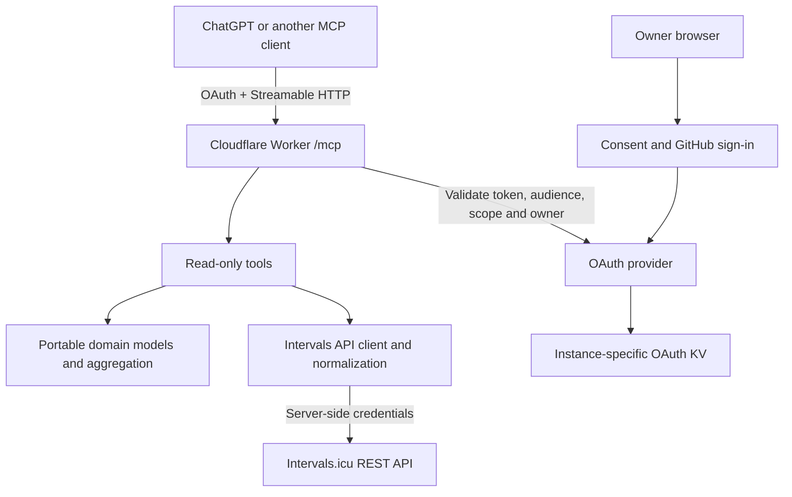

# intervals-icu-mcp

A read-only [Model Context Protocol](https://modelcontextprotocol.io/) server that lets ChatGPT and compatible clients query your Intervals.icu training data.

**Self-host one instance per owner.** Use your own Cloudflare account, Intervals API credentials, GitHub OAuth app and OAuth storage. Maintainers do not host a shared service or collect credentials. Existing COROS/other activity synchronization stays external.

## Architecture



The upstream client, domain logic, tool contracts, MCP transport and authentication are separate modules. There is no athlete database, background synchronization, write API or coaching logic.

## Local setup

Requires **Node.js 22.14+ or 24 LTS**, **pnpm 10.34.9**, Intervals.icu, GitHub and Cloudflare accounts.

1. Clone this repository and install dependencies:

   ```bash
   git clone https://github.com/rbernanda/intervals-icu-mcp.git
   cd intervals-icu-mcp
   pnpm install --frozen-lockfile
   ```

2. Get your personal API key from [Intervals.icu Settings](https://intervals.icu/settings). Athlete ID `0` selects the key owner; an explicit athlete ID also works.
3. Create a development **GitHub OAuth app** with homepage `http://localhost:8787` and callback `http://localhost:8787/callback`. Obtain your numeric GitHub user ID (`gh api user --jq .id` if the CLI is authenticated).
4. Run:

   ```bash
   pnpm setup:local
   pnpm dev
   ```

The wizard hides input and creates an ignored, mode-0600 `.dev.vars`. Set the athlete's actual IANA timezone. `.dev.vars.example` and `.env.example` are alternative templates; never commit filled-in copies or paste keys into chat.

Use the exact configured origin: `localhost` and `127.0.0.1` differ. Local requests require OAuth too. Hosted ChatGPT needs your deployed HTTPS URL.

## Deploy your instance

These commands create resources in **your account**. Run them only when ready to deploy:

```bash
pnpm wrangler login
pnpm wrangler kv namespace create OAUTH_KV --update-config=false
pnpm setup:deploy
```

The offline wizard asks for your intended HTTPS origin, namespace ID, production GitHub OAuth app client ID, numeric owner ID and timezone. Its GitHub callback must be `<origin>/callback`. It creates an ignored `wrangler.instance.jsonc`; no source edits or credentials in configuration are required.

Enter credentials through Workers Secrets prompts, then review and deploy:

```bash
pnpm wrangler secret put INTERVALS_API_KEY --config wrangler.instance.jsonc
pnpm wrangler secret put INTERVALS_ATHLETE_ID --config wrangler.instance.jsonc
pnpm wrangler secret put GITHUB_CLIENT_SECRET --config wrangler.instance.jsonc
pnpm build:instance
pnpm deploy:instance
```

`build` and `build:instance` are dry runs; **`deploy:instance` deploys**. Reuse your instance's namespace for updates, never between owners. Verify Wrangler's actual URL matches `PUBLIC_ORIGIN` and your GitHub callback.

For account setup, configuration, updates and verification, follow the [self-hosting guide](docs/self-hosting.md).

## Connect a client

In **ChatGPT → Plugins → Add custom MCP server**, enter your deployed `https://<your-worker-origin>/mcp` and choose **OAuth/CIMD** if offered. Desktop forms use **Streamable HTTP**, then **Authenticate** after saving. Leave manual client credentials empty. Review consent, sign in with the configured GitHub account, enable the seven read tools, and compare the athlete profile/latest runs with Intervals. Menu placement may vary.

Authentication uses authorization-code OAuth with S256 PKCE. Every tool request checks token audience, expiry, scope and owner. Access tokens last 15 minutes; refresh grants last 30 days.

Other clients can use CIMD or opt-in DCR (`OAUTH_ENABLE_DCR=true`). Registering a client never grants athlete access. Additional browser origins must be exact entries in `MCP_ALLOWED_ORIGINS`; wildcards are rejected. See [client compatibility and Inspector setup](docs/clients.md) for supported behavior and limitations.

## Tools

| Tool                    | Inputs                                                      | Returns                                                               |
| ----------------------- | ----------------------------------------------------------- | --------------------------------------------------------------------- |
| `get_athlete_profile`   | None                                                        | Identity, timezone, weight and sport settings                         |
| `get_recent_activities` | Optional dates, `limit` (20 default, 100 max), `sport_type` | Newest-first activity summaries; last 28 days by default              |
| `get_activity_details`  | `activity_id`, optional `include_intervals`                 | Owned activity details and up to 200 intervals                        |
| `get_fitness_trend`     | `start_date`, `end_date`                                    | Source CTL/ATL, load fields and labeled computed form                 |
| `get_wellness`          | `start_date`, `end_date`                                    | Available resting HR, HRV, sleep, weight and subjective scores        |
| `get_training_calendar` | `start_date`, `end_date`                                    | Planned events and explicitly paired completed activities             |
| `get_training_summary`  | `days`: 7/14/28/42/90 (28 default), optional sport          | Covered totals, weekly running volume, longest run and latest fitness |

Dates are inclusive `YYYY-MM-DD`, limited to 90 days. `Run`/`running` includes Run, TrailRun and VirtualRun. Outputs include provenance, retrieval time, units and missing-data warnings.

- Units: meters, seconds, m/s, seconds/km, bpm, watts and kilograms. Moving and elapsed time remain separate. Running cadence retains source rpm and explicitly derives spm.
- CTL/ATL come from Intervals. No daily source TSB field is documented; **same-day CTL − ATL is labeled computed**, not a percentage or previous-day TSB convention. Source `ctlLoad` and `atlLoad` stay distinct.
- Missing values stay null. Incomplete inputs produce null totals with coverage counts. Weeks start Monday; partial weeks are marked.
- Original device laps and all wellness fields may be unavailable; Strava-origin stubs can restrict data. HRV methods and subjective-score scales remain source-defined.
- No high-frequency streams are fetched. Saturated ranges (1000 activities or 300 events) cannot silently produce complete summaries.

## Verify and contribute

```bash
pnpm types:check
pnpm check
pnpm types:portable
pnpm verify:runtime
```

Checks run without credentials. Runtime verification builds the actual Worker and exercises the official MCP Inspector and smoke script with synthetic data. [GitHub Actions](.github/workflows/ci.yml) runs on Node 22/24 with read-only permissions and no deployment step.

Local protocol tests, deployed endpoint validation, live Intervals retrieval and a successful ChatGPT connection are separate checks. See [validation evidence](docs/validation.md). `pnpm smoke` can verify a live instance with a legitimately issued OAuth token supplied locally; see the guides for safe handling.

Troubleshooting: a configuration error returns 503; missing/expired OAuth returns 401; wrong owner/scope/origin returns 403. Check upstream keys and athlete ID for API errors, wait for `Retry-After` on rate limits, and narrow oversized ranges. Detailed steps are in the [self-hosting](docs/self-hosting.md) and [client](docs/clients.md) guides.

Contributions are welcome under the [MIT License](LICENSE). Read [CONTRIBUTING.md](CONTRIBUTING.md) and [SECURITY.md](SECURITY.md). Use synthetic fixtures only. KV revocation is eventually consistent; protect accounts and tokens. Report vulnerabilities privately, without athlete data or credentials.
